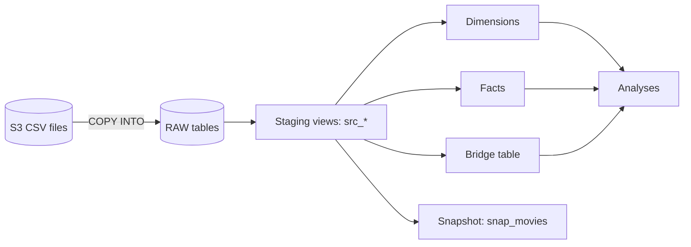

# MovieLens Analytics Warehouse: dbt + Snowflake

An ELT project that loads the MovieLens 20M dataset from S3 into Snowflake and models it with dbt Core into a tested, documented star schema: staging views, dimensions, facts, a many-to-many bridge table, an incremental ratings fact, and a snapshot for slowly changing movie attributes.

> **A note on the name.** The dataset is [MovieLens](https://www.kaggle.com/datasets/grouplens/movielens-20m-dataset) from Kaggle, not Netflix data. "Netflix" in the project name is a label to get a quick idea about the data.

## Contents

- [Tech stack](#tech-stack)
- [Architecture](#architecture)
- [Data model](#data-model)
- [Design decisions](#design-decisions)
- [Testing](#testing)
- [Analyses](#analyses)
- [Getting started](#getting-started)
- [Repository structure](#repository-structure)
- [Known limitations and next steps](#known-limitations-and-next-steps)
- [Data source and citation](#data-source-and-citation)

## Tech stack

| Layer | Tool |
|---|---|
| Storage and archive | Amazon S3 (CSV files) |
| Warehouse | Snowflake (`MOVIELENS` database) |
| Loading | Snowflake `COPY INTO` from an external stage |
| Transformation and testing | dbt Core 1.12.6 with dbt-snowflake 1.12.4 |
| Runtime | Python 3.14, macOS, VS Code |

## Architecture



| Layer | Medallion name | Where | Contents |
|---|---|---|---|
| Archive | | S3 | The original CSV files, never modified |
| Raw | Bronze | `MOVIELENS.RAW` | Six tables loaded from the files. Append-only. Values are typed at load time, and `raw_ratings` carries two audit columns: `loaded_at` (when Snowflake read the file) and `source_file` (which S3 file the row came from) |
| Staging | Silver | `MOVIELENS.DEV`, views | One `src_*` view per raw table. Renames columns and casts timestamps. No business logic |
| Marts | Gold | `MOVIELENS.DEV`, tables | Dimensions, facts, and a bridge table built for analysis |

dbt only reads the raw tables and never changes them. Loading into them happens in Snowflake, outside dbt, and the raw tables are declared as sources in `models/staging/sources.yml`.

## Data model

| Model | Type | Grain (one row per) | Key |
|---|---|---|---|
| `dim_movies` | Dimension | movie (27,278 rows) | `movie_id` |
| `dim_users` | Dimension | user | `user_id` |
| `dim_genome_tags` | Dimension | genome tag (1,128 rows) | `tag_id` |
| `fct_ratings` | Fact (incremental) | user and movie pair | `user_id` + `movie_id` |
| `fct_genome_scores` | Fact | movie and tag pair (11,709,768 rows) | `movie_id` + `tag_id` |
| `bridge_movie_genres` | Bridge | movie and genre pair (54,406 rows) | `movie_id` + `genre` |
| `snap_movies` | Snapshot | version of a movie | `movie_id` + validity dates |

**Relationships**

| From | To | Cardinality |
|---|---|---|
| `dim_movies` | `fct_ratings` | one to many |
| `dim_users` | `fct_ratings` | one to many |
| `dim_movies` | `fct_genome_scores` | one to many |
| `dim_genome_tags` | `fct_genome_scores` | one to many |
| `dim_movies` | genres | many to many, resolved by `bridge_movie_genres` |

## Design decisions

**Layering.** Raw data stays untouched, staging only renames and casts, and business logic lives in the marts. Each layer has one job, so a bug is easy to locate and a source change only affects staging.

**Incremental ratings by arrival time.** `fct_ratings` is incremental and merges on `(user_id, movie_id)`. Its filter uses `loading_timestamp` (when a row arrived in Snowflake), not `rating_timestamp` (when the user rated the movie). A filter on event time would permanently drop late or backfilled rows whose rating date is older than the newest row already loaded. Filtering on arrival time picks them up. Because the table is merged on its key, a corrected rating replaces the old one, and the full history stays in `raw_ratings`.

**Lookback window for parallel loads.** In a pipeline where loads can run in parallel or overlap, I would add a lookback window to the incremental filter (for example, one hour behind the newest `loading_timestamp`) and rely on the merge key to absorb the rows that get read twice. This project loads one file at a time and runs dbt afterwards, so a lookback is not needed here.

**Many-to-many genres.** A movie can have several genres, so `dim_movies` keeps the raw pipe-separated string and an array, and `bridge_movie_genres` holds one row per movie and genre for filtering and grouping in BI tools. When a bridge table is joined to ratings, a rating counts once per genre, so averages by genre are valid but counts should not be added up across genres.

**Snapshot for slowly changing attributes.** `snap_movies` keeps a version history of movie attributes with validity dates. History models on top of a snapshot should expose a current-only view for dashboards, to avoid duplicated rows in joins.

**The genome tables are separate from user tags.** User tags are sparse, free-text, one row per application. The tag genome is a dense machine-learning-derived matrix: every movie in it has a relevance score from 0 to 1 for every genome tag. Because the matrix is dense, a `relevance > 0` filter removes no rows.

**Naming.** Staging models use the `src_` prefix, dimensions `dim_`, facts `fct_`.

## Testing

`dbt build` runs 20 data tests: key tests (`unique`, `not_null`) on the dimensions and facts, relationship tests between facts and dimensions, and a singular test (`tests/relevance_score_validity_test.sql`) that returns any genome score that is null or outside the range 0 to 1. A singular test passes when it returns no rows.

**Testing the incremental logic.** To check late-arriving data, I loaded two small synthetic files after the original ratings file: a new batch of ratings, and a backfill file with old rating dates plus corrections to three existing ratings. The result matched expectations: backfilled rows were picked up despite their old dates, and corrected ratings updated in place instead of duplicating. These files use user IDs of 200001 and above, so exclude `user_id >= 200001` when analyzing real behavior.

## Analyses

`analyses/movie_analysis.sql` holds five queries that are compiled but not run by dbt:

1. Top-rated movies with at least 100 ratings
2. Average rating by genre
3. Ratings per user (engagement)
4. Movie releases over time
5. Average genome relevance by tag

Compile them with `dbt compile --select movie_analysis`, then run the compiled SQL from `target/compiled/` in a Snowflake worksheet.

## Getting started

### Prerequisites

- A Snowflake account, with a database `MOVIELENS`, schemas `RAW` and `DEV`, a role `TRANSFORM`, a warehouse, and a user for dbt
- An S3 bucket with the MovieLens CSV files, exposed to Snowflake as an external stage (`@netflixstage` in this project)
- Python 3.10 or later. This project was built on 3.14 with dbt 1.12

### Load the raw data

The raw files are not stored in this repository. Download MovieLens 20M from [GroupLens](https://grouplens.org/datasets/movielens/20m/), upload the CSVs to your bucket, create the raw tables, and load them. For example, for ratings:

```sql
COPY INTO raw_ratings (userId, movieId, rating, rating_ts, loaded_at, source_file)
FROM (
    SELECT $1, $2, $3, $4, METADATA$START_SCAN_TIME::TIMESTAMP_NTZ, METADATA$FILENAME
    FROM @netflixstage
)
PATTERN = '.*rating.*[.]csv'
FILE_FORMAT = (TYPE = 'CSV' SKIP_HEADER = 1 FIELD_OPTIONALLY_ENCLOSED_BY = '"' ESCAPE = '\\');
```

Snowflake remembers which files it has loaded, so a new file is loaded once and previously loaded files are skipped. Give every new file a unique name.

### Run the project

```bash
git clone <repo-url>
cd <repo-folder>
python3 -m venv .venv
source .venv/bin/activate
pip install -r requirements.txt

cd dbtnetflix
dbt deps
dbt build
dbt docs generate && dbt docs serve
```

### Connection profile

dbt reads credentials from `~/.dbt/profiles.yml`, which is outside the repository so that no secret is committed:

```yaml
dbtnetflix:
  target: dev
  outputs:
    dev:
      type: snowflake
      account: <your-account-identifier>
      user: <your-user>
      password: "{{ env_var('SNOWFLAKE_PASSWORD') }}"
      role: TRANSFORM
      warehouse: <your-warehouse>
      database: MOVIELENS
      schema: DEV
      threads: 1
```

Set the password in your shell with `export SNOWFLAKE_PASSWORD=...` before running dbt.

## Repository structure

```
.
├── requirements.txt
└── dbtnetflix/
    ├── dbt_project.yml
    ├── packages.yml
    ├── analyses/          # movie_analysis.sql
    ├── models/
    │   ├── schema.yml     # model descriptions and tests
    │   ├── staging/       # sources.yml and src_* views
    │   ├── bridge/        # bridge_movie_genres
    │   └── marts/
    │       ├── dim/       # dim_movies, dim_users, dim_genome_tags
    │       └── fct/       # fct_ratings, fct_genome_scores
    ├── seeds/             # seed_movie_release_dates.csv
    ├── snapshots/         # snap_movies
    └── tests/             # singular tests
```

## Known limitations and next steps

- **Dashboard.** No BI layer yet. A natural next step is a Tableau or Power BI dashboard on top of the marts.
- **Event-time guard on ratings.** The merge on `fct_ratings` overwrites a rating with whatever row loaded last. A stale re-delivery with an older `rating_timestamp` should not win, so a per-key event-time comparison is a planned improvement.
- **Grain of the ratings fact.** `fct_ratings` is a current-state table (one row per user and movie). An append-only event-grain fact with a "current ratings" model on top would keep rating history in the mart.
- **Scheduling.** Loading and dbt runs are manual. In production, an orchestrator would run the load, then `dbt build`.
- **Source freshness checks** are not configured, because the data is a static dump.
- **Raw column typing.** The raw layer is typed at load time. A fully text-based raw layer would make loads more tolerant of malformed values.

**Known data quality notes.** A few source rows are written in a way that breaks strict CSV parsing. Some titles in `movie.csv` contain backslash-escaped quotes (`\"`), and three tags in `tag.csv` end with a lone backslash, which a backslash escape setting reads as an escaped quote. These rows need an escape setting together with a small correction (doubling the trailing backslash), or the lines can be loaded as raw text and split in SQL.

## Data source and citation

Data: [MovieLens 20M](https://www.kaggle.com/datasets/grouplens/movielens-20m-dataset) from Kaggle 

> F. Maxwell Harper and Joseph A. Konstan. 2015. The MovieLens Datasets: History and Context. *ACM Transactions on Interactive Intelligent Systems* 5, 4, Article 19.
